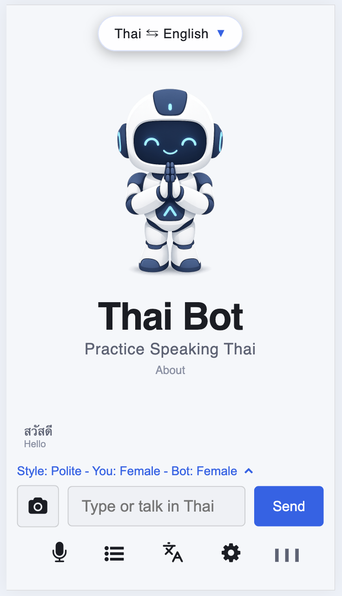
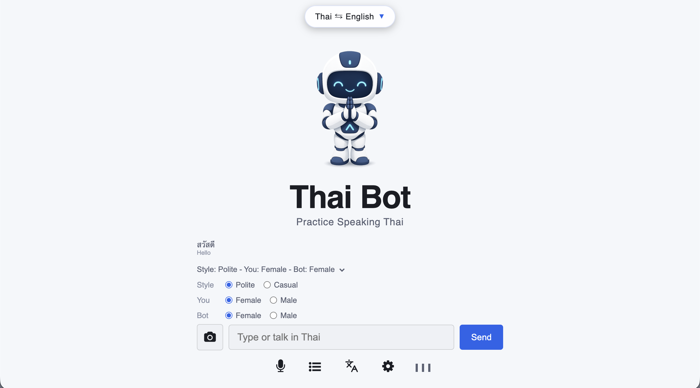

# Thai Bot - Practice Thai Conversation

Thai Bot (T-Bot) is a free AI powered chatbot for practicing Thai conversation. 

Live Demo: 
  
https://t-bot.woza.work/

 
 

 

Minimalist mobile optimized UI

 

## Quick Info
- Supports both voice and text inputs
- Mobile optimized web app
- Minimalist and visually calm UI design
- Frontend: Html, CSS, Javascript
- Backend: PHP
- Set up as a three-agent LLM system - chat, correction, translation
- Uses Javascript SpeechRecognition to convert the user's speech into text.
- Uses Javascript SpeechSynthesis to convert text to speech
- Has visual audio cues for deaf learners
- Can be deployed on any website hosting platform

 

## Deployment Notes

- Add your OpenRouter API key to the ebot_config.ini.txt file before uploading to your web host server.
- Change the name of the file from ebot_config.ini.txt to ebot_config.ini
- For added security it's best to locate the ebot_config.ini file outside the web host root folder.

 

## References

- List of Free Language Practice Chatbots 
https://github.com/vbookshelf/List-of-Free-Language-Practice-Chatbots

 
  
